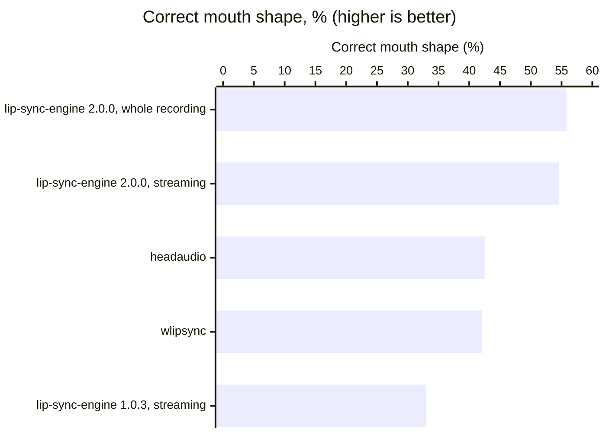
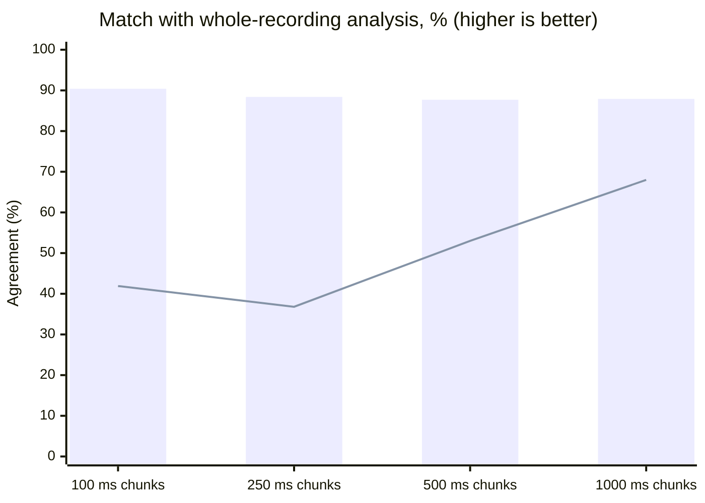
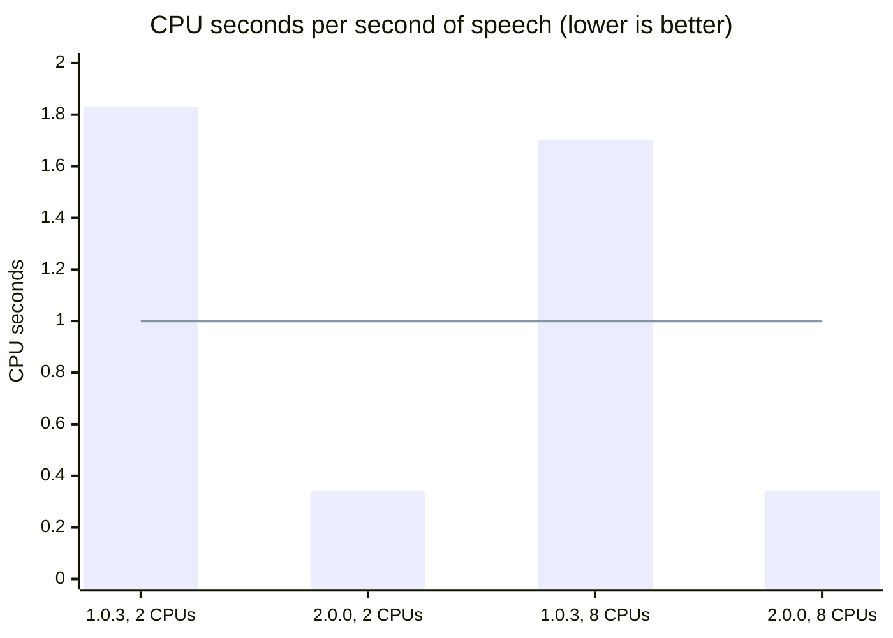

# Benchmarks

How lip-sync-engine 2.0.0 compares with 1.0.3 and with two other browser lip-sync libraries on accuracy, speed, and memory. For what changed between the versions, see [CHANGELOG.md](./CHANGELOG.md).

## At a Glance

Streaming speech in 250 ms chunks, 2 workers, 8 logical CPUs. Accuracy is measured against independent phone labels; see [Head-to-Head](#head-to-head-with-other-browser-lip-sync-libraries) for the method.

| Library and setup | Accuracy¹ (higher is better) | m, b, p shown with closed lips (higher is better) | CPU per second of audio² (lower is better) | Delay before the first cues (lower is better) | Memory per worker (lower is better) |
|---|---|---|---|---|---|
| **lip-sync-engine 2.0.0**, context and lookahead | **54.6%** | **92%** | 0.34 s | 120 ms | about 115 MB |
| lip-sync-engine 1.0.3, chunks analyzed alone | 33.0% | 90% | 1.70 s | 489 ms | about 170 MB, growing |
| headaudio 1.1.0 | 42.5% | 48% | 0.007 s | about 30 to 40 ms | not measured |
| wlipsync 1.3.1 | 42.1% | 47% | 0.009 s | about 30 to 40 ms | not measured |

¹ Balanced accuracy over five mouth classes; chance is 20%. ² lip-sync-engine was measured in Chromium (all browser processes), the other libraries in Node, so compare orders of magnitude only.

In short:

- **2.0.0 with context and lookahead is the most accurate option tested,** about 12 points above the other libraries and within 1 to 3 points of analyzing each utterance in one call.
- **2.0.0 is about 5 times faster than 1.0.3** per chunk and uses under a quarter of the CPU, so one worker keeps up with real-time speech.
- **The usual 1.0.3 streaming setup is the least accurate option tested.**
- **headaudio and wlipsync use 40 to 50 times less CPU** and react within about 30 to 40 ms, but show closed lips for fewer than half of m, b, and p sounds.
- **2.0.0 changes no output by itself:** with `extendedShapes: ''` and no context or lookahead, it returns the same cues as 1.0.3.

**How often each library shows the right mouth shape. Higher is better.** Scored against hand-labeled speech; random guessing scores 20%. "Streaming" means 250 ms chunks.



## Test Setup

- **Audio:** 116 s of read speech from CMU ARCTIC (speakers slt and bdl), joined into 8 utterances of about 15 s each. Each utterance was resampled to 24 kHz, cut into streaming chunks of 100, 250, 500, or 1000 ms, and each chunk was resampled to 16 kHz with linear interpolation before analysis. Timing tables use 4 of the utterances (about 60 s); quality tables use all 8.
- **Hardware:** Intel Core i5-8259U (4 cores, 8 threads), 64 GB RAM, Linux. "2 CPUs" means the browser was pinned to 2 logical CPUs (`taskset -c 0,1`) to approximate a low-end device.
- **Browser:** Chromium 159 (Playwright headless shell) with real Web Workers.
- **Versions:** the published npm packages 1.0.3 and 2.0.0. A source build of 1.0.3 with the current compiler measured the same within run-to-run variance.
- **Date:** November 2026.
- **Variance:** repeated runs of the same configuration differ by up to 10 to 20%. The differences reported here are much larger.

Metrics:

- **Fresh pool to first cue:** create a pool, call `init()` and `warmup()`, then analyze the first chunk.
- **Per chunk:** time for one `analyze()` call on a warm worker, chunks sent one at a time.
- **CPU per audio second:** CPU time of all browser processes during analysis, divided by seconds of audio analyzed.
- **Memory:** total PSS of all browser processes, minus the same figure before the pool existed.
- **First cues:** time from the first chunk's arrival until its cues are ready.
- **Stalls:** total time the player waits for a chunk's cues during one utterance.

## Head-to-Head with Other Browser Lip-Sync Libraries

The quality figures above use lip-sync-engine's own whole-utterance output as the reference, which would favor it. This comparison uses independent ground truth instead: the hand-checked phone timings published with CMU ARCTIC, trimmed and joined exactly like the test utterances.

**Setup:**

- **headaudio 1.1.0** and **wlipsync 1.3.1** ran offline in Node on the same 24 kHz audio, fed in AudioWorklet-sized blocks as their worklets do.
  - headaudio's output is its worklet's viseme stream, after its own majority vote.
  - wlipsync uses the example voice profile from its repository. No profile exists for these speakers, which puts it at a disadvantage; creating one requires Unity.
- **lip-sync-engine** ran in the browser as described in [Test Setup](#test-setup). Its 2.0.0 rows use the default nine shapes.
- **Common scale.** Each library uses a different set of mouth shapes, so the truth phones and every output are mapped to five mouth classes:
  - **closed:** silence, m, b, p
  - **f/v:** teeth on lip
  - **rounded:** uw, uh, ow, ao, w
  - **wide open:** aa, ae, aw, ay
  - **other:** all remaining sounds
- **Scoring.** On a 10 ms grid, at each library's best constant time shift. Frame-by-frame analyzers report slightly after the sound, and their documentation suggests delaying the audio to compensate. wlipsync also used its best loudness threshold for "mouth closed".

**Balanced accuracy** is the average of the five per-class hit rates, so the frequent "other" class does not dominate. Chance level is 20%.

| Library and setup | Balanced accuracy | Frame accuracy | m/b/p shown closed | Vowel frames shown closed | Best shift | Balanced accuracy at 0 shift |
|---|---|---|---|---|---|---|
| lip-sync-engine 1.0.3, 250 ms chunks alone | 33.0% | 46.6% | 90% | 29% | 0 ms | 33.0% |
| lip-sync-engine 2.0.0, 250 ms chunks alone | 35.4% | 46.8% | 90% | 29% | 10 ms | 35.4% |
| **lip-sync-engine 2.0.0, 250 ms chunks, context and lookahead** | **54.6%** | **68.0%** | **92%** | **4%** | -10 ms | **54.5%** |
| lip-sync-engine 2.0.0, 1000 ms chunks, context and lookahead | 55.2% | 68.2% | 93% | 4% | -10 ms | 55.1% |
| lip-sync-engine 2.0.0, whole utterance in one call | 55.8% | 68.5% | 93% | 4% | 0 ms | 55.8% |
| lip-sync-engine 2.0.0, whole utterance with transcript | 57.9% | 68.9% | 98% | 4% | 0 ms | 57.9% |
| headaudio 1.1.0 | 42.5% | 57.3% | 48% | 3% | 40 ms | 36.9% |
| wlipsync 1.3.1 (example profile) | 42.1% | 39.5% | 47% | 2% | 30 ms | 39.1% |

**Hit rate per class** (best shift):

| Library and setup | closed | f/v | rounded | wide open | other |
|---|---|---|---|---|---|
| lip-sync-engine 1.0.3, chunks alone | 73% | 0% | 37% | 3% | 52% |
| lip-sync-engine 2.0.0, context and lookahead (250 ms) | 51% | 57% | 70% | 15% | 80% |
| headaudio | 48% | 29% | 45% | 24% | 67% |
| wlipsync | 55% | 0% | 75% | 47% | 35% |

Observations:

- **lip-sync-engine 2.0.0 with context and lookahead scores highest,** about 12 points of balanced accuracy above the other libraries and within 1 to 3 points of analyzing the whole utterance at once.
- **It closes the lips for about 92% of m, b, and p sounds;** headaudio and wlipsync do so for under half.
- **Short chunks analyzed alone score lowest,** below both other libraries: the mouth closes on 29% of vowel frames, and 1.0.3 output has no f/v shape.
- **The other libraries are stronger on some classes.** wlipsync scores higher on wide-open (47%) and rounded (75%) vowels, and headaudio on wide-open vowels (24%). Rhubarb shows many wide vowels with its medium-open shape C, which counts as "other" on this scale.
- **The other libraries are far cheaper.** In Node on the same machine, headaudio used 7 ms and wlipsync 9 ms of CPU per second of audio, against about 300 to 400 ms for lip-sync-engine in the browser (different runtimes, so treat this as an order of magnitude). They also run with about 30 to 40 ms of delay and no startup cost.

Limits of this comparison:

- Phone labels do not match visible mouth shapes exactly, because neighboring sounds blend, and five classes is a coarse scale. Use the numbers to compare libraries, not as absolute accuracy.
- wlipsync would likely score higher with a profile made for these voices.
- Only two speakers of read speech were tested, not synthesized speech.

## Mouth-Cue Quality

Reference: each whole utterance analyzed in one call with its transcript. Results are compared on a 10 ms grid.

- **Agreement:** share of frames with the same mouth shape as the reference.
- **False closures:** share of frames within 150 ms of a chunk boundary where the result shows a closed mouth but the reference shows it open.

These tables use the six basic shapes (`extendedShapes: ''`) so that 1.0.3 and 2.0.0 compare like for like. "Context and lookahead" means `createStreamAnalyzer({ contextMs: 500, lookaheadMs: 500 })`, measured end to end. "Burst" means the audio arrives faster than playback; "3x" means it arrives at three times playback speed.

**Agreement:**

| Setup | 100 ms chunks | 250 ms | 500 ms | 1000 ms |
|---|---|---|---|---|
| Each chunk alone (1.0.3, and 2.0.0 with six shapes) | 41.9% | 36.8% | 53.0% | 68.0% |
| Context only (`contextMs: 500`) | 39.3% | 54.0% | 66.0% | 75.4% |
| Context and lookahead, burst | **90.4%** | **88.4%** | **87.7%** | **87.9%** |
| Context and lookahead, 3x | 83.4% | 81.8% | 83.1% | 85.3% |

The whole utterance analyzed in one call without a transcript reaches 94.2%.

**How closely streaming output matches analyzing the whole recording at once. Higher is better.** Bars: 2.0.0 with context and lookahead. Line: each chunk analyzed alone, as 1.0.3 does.



**False closures:**

| Setup | 100 ms chunks | 250 ms | 500 ms | 1000 ms |
|---|---|---|---|---|
| Each chunk alone | 10.8% | 33.7% | 25.6% | 24.9% |
| Context and lookahead, burst | 1.3% | 1.7% | 1.4% | 2.2% |

How the controller schedules context and lookahead without adding delay is described in [Context and Lookahead](./docs/streaming-analysis.md#context-and-lookahead).

**Latency and cost with context and lookahead** (2 workers, 8 CPUs unless stated; median per utterance, worst utterance in parentheses):

| Chunk size | Arrival | First cues | Stalls | CPU per audio second |
|---|---|---|---|---|
| 100 ms | burst | 2 ms | 933 ms (1274 ms) | 0.37 s |
| 250 ms | burst | 120 ms | 0 (68 ms) | 0.34 s |
| 500 ms | burst | 123 ms | 0 | 0.28 s |
| 1000 ms | burst | 296 ms | 0 | 0.32 s |
| 100 ms | 3x | 1 ms | 349 ms (497 ms) | 0.70 s |
| 250 ms | 3x | 98 ms | 0 (14 ms) | 0.67 s |
| 250 ms | burst, 2 CPUs | 110 ms | 0 (62 ms) | 0.34 s |

With 100 ms chunks, every chunk must be analyzed within a 100 ms rhythm, which causes stalls of about 0.3 to 0.9 s per utterance. For chunks that small, join them into chunks of at least 250 ms before analysis, or analyze each chunk alone and accept the lower quality.

**Nine shapes** (the default, `extendedShapes: 'GHX'`), scored against a nine-shape reference:

| Setup | 250 ms chunks | 1000 ms |
|---|---|---|
| Each chunk alone | 31.9% | 65.1% |
| Context and lookahead, burst | 85.1% | 86.4% |

Speed is unchanged. Agreement is slightly lower than with six shapes because there are more shapes to match exactly.

**Phonetic recognizer** (`recognizer: 'phonetic'`), measured in a separate run with context and lookahead. Compare the two rows with each other, not with the tables above:

| Recognizer | Agreement (250 / 1000 ms chunks) | CPU per audio second | Memory per additional worker | First chunk after `init()`/`warmup()` |
|---|---|---|---|---|
| Default (`'pocketsphinx'`) | 87.0% / 87.9% | 0.39 s | 140 MB | 136 ms |
| Phonetic | 61.9% / 62.0% | 0.12 s | 80 MB | 26 ms |

The phonetic recognizer is much cheaper but clearly less accurate. It is intended only for devices that cannot keep up otherwise.

## Speed and Memory

250 ms chunks. In the streaming columns, all chunks of an utterance arrive at once and each chunk is analyzed alone, without context or lookahead.

**2 CPUs:**

| Workers | Version | Fresh pool to first cue | Per chunk (median) | CPU per audio second | Streaming: first cues | Streaming: stalls | Memory after use |
|---|---|---|---|---|---|---|---|
| 1 | 1.0.3 | 783 ms | 414 ms | 1.76 s | 464 ms | 12.0 s | 384 MB |
| 1 | 2.0.0 | 671 ms | 93 ms | 0.44 s | 110 ms | 0 | 120 MB |
| 2 | 1.0.3 | 1160 ms | 442 ms | 1.83 s | 439 ms | 0 (worst utterance 0.3 s) | 507 MB |
| 2 | 2.0.0 | 933 ms | 71 ms | 0.34 s | 219 ms | 0 | 241 MB |
| 5 | 1.0.3 | 2638 ms | 414 ms | 1.76 s | 1324 ms | 0 | 861 MB |
| 5 | 2.0.0 | 1960 ms | 93 ms | 0.43 s | 242 ms | 0 | 577 MB |

**8 CPUs:**

| Workers | Version | Fresh pool to first cue | Per chunk (median) | CPU per audio second | Streaming: first cues | Streaming: stalls | Memory after use |
|---|---|---|---|---|---|---|---|
| 1 | 1.0.3 | 710 ms | 495 ms | 2.09 s | 499 ms | 16.5 s | not recorded¹ |
| 1 | 2.0.0 | 508 ms | 97 ms | 0.43 s | 170 ms | 0 | 127 MB |
| 2 | 1.0.3 | 965 ms | 419 ms | 1.70 s | 489 ms | 0.26 s | 508 MB |
| 2 | 2.0.0 | 915 ms | 73 ms | 0.34 s | 114 ms | 0 | 240 MB |
| 5 | 1.0.3 | 1525 ms | 438 ms | 1.82 s | 721 ms | 0 | 868 MB |
| 5 | 2.0.0 | 1154 ms | 85 ms | 0.40 s | 157 ms | 0 | 583 MB |

¹ The measurement overlapped work queued by the previous test, so it is omitted. The 1-worker "fresh pool" figures in both tables come from a separate run.

**CPU time needed for each second of speech, with 2 workers. Lower is better.** A bar above the line (1 second) means one worker cannot keep up with real-time speech.



Observations:

- **One 2.0.0 worker keeps up with real-time speech.** It needs about 0.4 CPU seconds per second of audio; 1.0.3 needs about 1.8, so with one worker it falls behind and playback stalls.
- **Memory is about 115 MB per warm 2.0.0 worker and stays flat.** A 1.0.3 worker grows with each call until allocation fails: with repeated 100 ms calls it failed after 482 calls, while a 2.0.0 worker completed 3000 calls with its heap steady at 128 MB.
- **More workers make a fresh pool slower,** most visibly on 2 CPUs (1.96 s with 5 workers, 0.67 s with 1), because all workers build their speech decoders at the same time. A pool that is kept between utterances does not pay this again.

## Configuration Guidance

For streaming use, these results support the following settings. Each links to the guide that explains it.

- **Keep one pool for the session** instead of creating one per utterance: the first chunk then takes about 0.1 s instead of the 0.5 to 2 s a fresh pool needs. See [Pool Lifecycle and Sizing](./docs/worker-usage.md#pool-lifecycle-and-sizing).
- **Use 1 or 2 workers.** Two 2.0.0 workers kept up without stalls for chunks of 250 ms or longer and use about 340 MB less than five.
- **Use `contextMs: 500` and `lookaheadMs: 500`.** See [Context and Lookahead](./docs/streaming-analysis.md#context-and-lookahead).
- **Join chunks shorter than 250 ms** before analysis.

## Reproducing the Results

The scripts are in [`bench/`](./bench). They need Node.js 20+, Python 3 with NumPy, `playwright-core` (a dev dependency), and a Chromium build; set `CHROME_PATH` to use a specific browser binary.

1. Download the CMU ARCTIC `slt` and `bdl` voices from [festvox.org/cmu_arctic](http://festvox.org/cmu_arctic/). Put the 16 kHz WAV files in one folder named `<speaker>_<id>.wav` (for example `slt_a0001.wav`) together with the transcript file `slt_txt.data`, and the phone labels in another folder named `<speaker>_<id>.lab`. Then build the test utterances:

   ```bash
   python3 -I bench/prepare-audio.py <arctic_dir> <audio_dir>
   ```

2. Prepare the variants to compare. For a published version, extract the package's `dist/` into a variant folder (`npm pack lip-sync-engine@1.0.3`). For the working tree, build it with Emscripten:

   ```bash
   bench/build-variant.sh <name> <variants_dir>
   ```

3. Run the measurements (prefix with `taskset -c 0,1` for the 2-CPU tables):

   ```bash
   node bench/run.mjs --variants npm103,<name> --variantsDir <variants_dir> \
     --audioDir <audio_dir> --out results.json --workers 2 --chunks 100,250,500,1000 \
     --scenarios memory,fresh,sequential,streaming,reference
   ```

   Use `--stream '{"contextMs":500,"lookaheadMs":500}'` for the context and lookahead rows, `--analyze '{"extendedShapes":""}'` for six-shape output, and `--pool '{"recognizer":"phonetic"}'` for the phonetic recognizer.

4. Score mouth-cue quality against the `reference` scenario (whole utterances with transcripts):

   ```bash
   node bench/quality.mjs --ref results.json:<name> --runs results.json:npm103,results.json:<name>
   ```

5. Repeat calls on one worker until it fails (`<origin>` is a server that serves `bench/bench.html` and the variants, as `run.mjs` does):

   ```bash
   node bench/leak.mjs <origin> <name> 3000
   ```

6. For the head-to-head comparison, build the ground truth, run the other libraries, and score all outputs:

   ```bash
   python3 -I bench/h2h/truth.py <arctic_wav_dir> <arctic_lab_dir> truth.json
   node bench/h2h/run-headaudio.mjs <headaudio_package_dir> <audio_dir> headaudio.json
   node bench/h2h/run-wlipsync.mjs <wlipsync_package_dir> <profile.json> <audio_dir> wlipsync.json
   node bench/h2h/score.mjs truth.json final=results.json#variants.<name>.sequential.250.cues \
     headaudio=headaudio.json#timeline wlipsync=wlipsync.json#timeline
   ```
