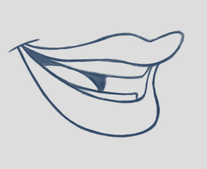
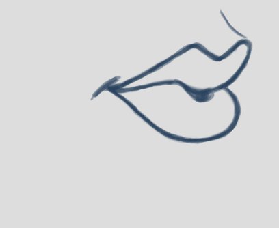
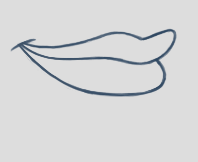

# 🎙️ LipSyncEngine.js

> High-quality lip-sync animation from audio in the browser

[](https://www.npmjs.com/package/lip-sync-engine)
[](./LICENSE)

WebAssembly port of [Rhubarb Lip Sync](https://github.com/DanielSWolf/rhubarb-lip-sync) with TypeScript support.

## ✨ Features

- 🚀 **High Performance** - Runs natively in browser via WebAssembly
- 🎯 **Accurate** - Uses PocketSphinx speech recognition for precise phoneme detection
- 📦 **Self-contained** - ~80 KB JavaScript + 1.9 MB WASM + ~40 MB speech models (cached by the browser, loaded once per worker)
- 🔧 **TypeScript** - Full type definitions included
- 🌐 **Framework-Agnostic** - Works with React, Vue, Svelte, vanilla JS, and any framework
- 🧵 **Web Workers** - Non-blocking analysis with worker pool
- 🔄 **Streaming Support** - Real-time chunk processing for live audio, with surrounding-audio context for near whole-utterance quality
- 🎨 **Complete API** - Audio utilities, format conversion, microphone recording
- 📱 **Browser-Native** - No server required, runs entirely client-side

## 🆕 What's New in 2.0.0

- **Faster calls.** Each worker now keeps its PocketSphinx decoder between calls instead of rebuilding it every time (about 0.4 s per call in 1.0.x). Analysing a 250 ms chunk dropped from about 450 ms to under 100 ms, and the first chunk on a pool kept from an earlier utterance from about 480 ms to about 130 ms (starting a fresh pool still takes about 0.5 to 1.2 s, because each worker now builds its decoder during `init()`/`warmup()`). With `extendedShapes: ''` the output is frame-for-frame identical to 1.0.3 for the same input. Calls with a new `dialogText` still build a decoder for that text (each worker caches one for the most recent text), so the speed-up applies to calls without `dialogText` or with the same text as the previous call.
- **No more out-of-memory workers.** 1.0.x workers ran out of memory after roughly 480 calls. That is fixed, so **keep the pool alive between utterances** instead of destroying and re-creating it.
- **Better streaming quality.** `createStreamAnalyzer()` can analyse each chunk together with the audio around it (`contextMs`, `lookaheadMs`). In our streaming test this raised agreement with whole-utterance analysis from 37-68% to 82-90%, and cut false lip closures at chunk boundaries from 11-34% of frames to about 2% (see [Streaming Quality](#-streaming-quality)).
- **Nine mouth shapes by default (breaking change).** Results now use Rhubarb's full set: A-F plus G (F, V), H (L) and X (idle), as Rhubarb's own tool does. If your avatar only has art for A-F, pass `extendedShapes: ''` to get 1.x output back. With 500 ms context and lookahead, nine-shape streaming reaches 85-86% agreement with a nine-shape whole-answer reference.
- **New pool options and methods:** `init({ prewarm, shareAssets, recognizer })`, `pool.getMemoryStats()`, and `getResult(index)` / `end()` on the stream controller. Pending `init()`, `warmup()` and analysis promises now reject with the exported `WorkerPoolDestroyedError` when `destroy()` is called.

See [BENCHMARK.md](./BENCHMARK.md) for the full performance measurements.

## 📦 Installation

```bash
npm install lip-sync-engine
```

## 🚀 Quick Start

### Vanilla JavaScript / TypeScript

```typescript
import { analyze, recordAudio } from 'lip-sync-engine';

// Record audio from microphone
const { pcm16 } = await recordAudio(5000); // 5 seconds

// Analyze
const result = await analyze(pcm16, {
  dialogText: "Hello world", // Optional, improves accuracy
  sampleRate: 16000
});

// Use mouth cues for animation
result.mouthCues.forEach(cue => {
  console.log(`${cue.start}s - ${cue.end}s: ${cue.value}`);
  // Output: 0.00s - 0.35s: X
  //         0.35s - 0.50s: D
  //         0.50s - 0.85s: B
  //         ...
});
```

### React

```tsx
import { useState, useEffect, useRef } from 'react';
import { LipSyncEngine, recordAudio } from 'lip-sync-engine';

function useLipSyncEngine() {
  const [result, setResult] = useState(null);
  const lipSyncEngineRef = useRef(LipSyncEngine.getInstance());

  useEffect(() => {
    // Loads WASM from CDN automatically
    lipSyncEngineRef.current.init();
    return () => lipSyncEngineRef.current.destroy();
  }, []);

  const analyze = async (pcm16, options) => {
    const result = await lipSyncEngineRef.current.analyze(pcm16, options);
    setResult(result);
  };

  return { analyze, result };
}

function MyComponent() {
  const { analyze, result } = useLipSyncEngine();

  const handleRecord = async () => {
    const { pcm16 } = await recordAudio(5000);
    await analyze(pcm16, { dialogText: "Hello world" });
  };

  return (
    <div>
      <button onClick={handleRecord}>Record & Analyze</button>
      {result && <div>Found {result.mouthCues.length} mouth cues!</div>}
    </div>
  );
}
```

See [examples/react](./examples/react) for complete example.

### Vue

```vue
<script setup lang="ts">
import { ref, onMounted, onUnmounted } from 'vue';
import { LipSyncEngine, recordAudio } from 'lip-sync-engine';

const result = ref(null);
const lipSyncEngine = LipSyncEngine.getInstance();

// Loads WASM from CDN automatically
onMounted(() => lipSyncEngine.init());
onUnmounted(() => lipSyncEngine.destroy());

const handleRecord = async () => {
  const { pcm16 } = await recordAudio(5000);
  result.value = await lipSyncEngine.analyze(pcm16, { dialogText: "Hello world" });
};
</script>

<template>
  <div>
    <button @click="handleRecord">Record & Analyze</button>
    <div v-if="result">Found {{ result.mouthCues.length }} mouth cues!</div>
  </div>
</template>
```

See [examples/vue](./examples/vue) for complete example.

### Svelte

```svelte
<script>
import { writable } from 'svelte/store';
import { LipSyncEngine, recordAudio } from 'lip-sync-engine';

const result = writable(null);
const lipSyncEngine = LipSyncEngine.getInstance();

// Loads WASM from CDN automatically
lipSyncEngine.init();

async function handleRecord() {
  const { pcm16 } = await recordAudio(5000);
  const res = await lipSyncEngine.analyze(pcm16, { dialogText: "Hello world" });
  result.set(res);
}
</script>

<button on:click={handleRecord}>Record & Analyze</button>
{#if $result}
  <div>Found {$result.mouthCues.length} mouth cues!</div>
{/if}
```

See [examples/svelte](./examples/svelte) for complete example.

## 🌐 WASM Loading

**CDN by default** - No bundler configuration needed! WASM files are automatically loaded from unpkg.com CDN. This works out of the box with all bundlers (Vite, Webpack, Rollup, etc.).

```typescript
// Just call init() - that's it!
await lipSyncEngine.init();

// Or pin to a specific version for production:
await lipSyncEngine.init({
  wasmPath: 'https://unpkg.com/lip-sync-engine@2.0.0/dist/wasm/lip-sync-engine.wasm',
  dataPath: 'https://unpkg.com/lip-sync-engine@2.0.0/dist/wasm/lip-sync-engine.data',
  jsPath: 'https://unpkg.com/lip-sync-engine@2.0.0/dist/wasm/lip-sync-engine.js'
});
```

For self-hosting, copy `node_modules/lip-sync-engine/dist/wasm/*` (and `dist/worker.js` if you use `WorkerPool`) to your public directory and pass `wasmPath`, `dataPath` and `jsPath` (plus `workerScriptUrl` in `WorkerPool.init()`).

## 📚 Examples

- [Vanilla JS](./examples/vanilla/README.md)
- [React](./examples/react/README.md)
- [Vue](./examples/vue/README.md)
- [Svelte](./examples/svelte/README.md)

## 🎨 Mouth Shapes (Visemes)

LipSyncEngine.js outputs Rhubarb Lip Sync's mouth shapes (definitions from `src/cpp/core/Shape.h`). The six basic shapes are:

| Shape | Image | Description | Example Sounds |
|-------|-------|-------------|----------------|
| A |  | Closed mouth | m, b, p |
| B |  | Clenched teeth, slightly open | most consonants, ee as in b**ee** |
| C |  | Open mouth | e as in m**e**n, u as in s**u**n |
| D |  | Wide open | a as in f**a**ther, b**a**t |
| E |  | Rounded | o as in **o**ff |
| F |  | Puckered lips | y**ou**, b**oy**, **w**ay |

Since 2.0.0 results also use Rhubarb's three extended shapes, nine in total (silence is shown as X):

| Shape | Image | Description | Example Sounds |
|-------|-------|-------------|----------------|
| G |  | Upper teeth on lower lip | f, v |
| H |  | Tongue raised behind teeth | long l |
| X |  | Idle, relaxed | silence |

To get only A to F, as in 1.x (for avatars without G, H and X art), pass `extendedShapes: ''`. Any subset works, for example `'X'` for just the idle shape:

```typescript
const result = await pool.analyze(pcm16, { sampleRate: 16000, extendedShapes: '' }); // A-F only
```

## 🔬 How It Works

1. **Speech Recognition** - PocketSphinx analyzes audio to detect phonemes
2. **Phoneme Mapping** - Phonemes are mapped to Preston Blair mouth shapes
3. **Timing Optimization** - Animation is smoothed for natural transitions
4. **JSON Output** - Returns timestamped mouth shape cues

## 🎯 Streaming Quality

Recognition needs surrounding audio. When short streaming chunks are analysed one at a time, most mouth shapes are lost and the mouth snaps shut at chunk boundaries. Analysing each chunk with 500 ms of context and 500 ms of lookahead fixes most of this.

**How we measured.** 116 s of real read speech (CMU ARCTIC, 2 speakers), split into 8 "answers" of about 15 s each. Each answer was streamed as 24 kHz chunks and resampled to 16 kHz, like a realtime voice app. The reference is the whole answer analysed in one call with its transcript. Mouth cues were compared on a 10 ms grid.

- **Agreement**: share of frames with the same mouth shape as the reference.
- **False closures**: frames within 150 ms of a chunk boundary where the result shows a closed mouth but the reference shows it open.

These tables use the six basic shapes (`extendedShapes: ''`), so 1.0.3 and 2.0.0 are compared like for like. With the 2.0.0 default of nine shapes, scored against a nine-shape reference, results are similar: 31.9% (250 ms) and 65.1% (1000 ms) for chunks analysed alone, 85.1% and 86.4% with context and lookahead.

**Agreement with the reference** (higher is better):

| Setup | 100 ms chunks | 250 ms | 500 ms | 1000 ms |
|---|---|---|---|---|
| Each chunk analysed alone (1.0.3, and 2.0.0 with `extendedShapes: ''`) | 41.9% | 36.8% | 53.0% | 68.0% |
| 2.0.0, `contextMs: 500, lookaheadMs: 500`, audio arriving faster than playback | **90.4%** | **88.4%** | **87.7%** | **87.9%** |
| 2.0.0, same options, audio arriving at 3x playback speed | 83.4% | 81.8% | 83.1% | 85.3% |

**False closures at chunk boundaries** (lower is better):

| Setup | 100 ms chunks | 250 ms | 500 ms | 1000 ms |
|---|---|---|---|---|
| Each chunk analysed alone (1.0.3, and 2.0.0 with `extendedShapes: ''`) | 10.8% | 33.7% | 25.6% | 24.9% |
| 2.0.0, `contextMs: 500, lookaheadMs: 500`, audio arriving faster than playback | **1.3%** | **1.7%** | **1.4%** | **2.2%** |

For comparison, analysing the whole answer in one call without a transcript reaches 94.2% agreement. At 100 ms chunks analysed alone, almost every chunk comes out as a single "B" shape. With `extendedShapes: ''` and no context or lookahead, 2.0.0 gives exactly the same results as 1.0.3.

**Phonetic recognizer.** `init({ recognizer: 'phonetic' })` recognises phones without words. It is much cheaper (about 0.12 vs 0.39 CPU seconds per second of audio, about 80 vs 140 MB per extra worker in the same run, first chunk after `init()`/`warmup()` in about 26 ms vs 136 ms), but mouth shapes are clearly worse: about 62% agreement with context and lookahead at 250 ms and 1000 ms chunks, against 87-88% for the default recognizer. It also ignores `dialogText`. Use it only on weak devices or when speed matters more than accuracy.

## ⚖️ How It Compares to Other Browser Lip-Sync Libraries

We compared them on the same 116 s of read speech against independent ground truth (hand-checked phone timings from CMU ARCTIC), with each library's output and the truth mapped to five mouth classes (closed, f/v, rounded, wide open, other). Balanced accuracy is the average hit rate over those classes; chance is 20%. Details and caveats are in [BENCHMARK.md](./BENCHMARK.md#head-to-head-with-other-browser-lip-sync-libraries).

| | Balanced accuracy | m/b/p shown closed | CPU per audio second |
|---|---|---|---|
| lip-sync-engine 2.0.0, 250 ms streaming chunks with context and lookahead | **54.6%** | **92%** | ~350 ms |
| lip-sync-engine 1.0.3, 250 ms chunks analysed alone | 33.0% | 90% (but 29% of vowels shown closed too) | ~1800 ms |
| HeadAudio 1.1.0 | 42.5% | 48% | ~7 ms |
| wlipsync 1.3.1 (example voice profile) | 42.1% | 47% | ~9 ms |

The table below summarises how each one works.

| | lip-sync-engine | [HeadAudio](https://github.com/met4citizen/HeadAudio) | [wlipsync](https://github.com/mrxz/wlipsync) |
|---|---|---|---|
| Method | Full speech recognition (PocketSphinx) plus Rhubarb's animation rules | MFCC features, nearest-prototype classifier over 39 phoneme prototypes | MFCC features matched against per-vowel profiles (port of uLipSync) |
| Output | 9 Rhubarb mouth shapes (A-H, X), or 6 with `extendedShapes: ''` | 15 Oculus visemes | Vowels (A, I, U, E, O, silence) and volume |
| Runs in | Web Workers (WASM) | AudioWorklet | AudioWorklet (WASM) |
| Size | 1.9 MB WASM + ~40 MB models | 14 kB model | ~12 KB WASM |
| Latency | Per chunk, plus lookahead for best quality | ~16 ms frames, ~50 ms claimed latency | ~11 ms hop |
| Cost | ~115 MB and ~0.5 s decoder build per worker, ~0.3-0.4 CPU s per audio second | ~7 ms CPU per audio second, under 1 MB | ~9 ms CPU per audio second, under 1 MB |
| Model / setup | Bundled English models, no setup | Bundled English model trained on ~40 min of Kokoro TTS voices | Needs a per-voice profile calibrated in Unity |

- **lip-sync-engine** keeps closed-lip shapes (M, B, P) and their timing, because it recognises the actual phones. It also shows F/V (G), L (H) and idle (X). The cost is memory, CPU, start-up time, and the need for surrounding audio (context and lookahead) to reach its best quality.
- **HeadAudio** is far cheaper and nearly instant. Its own README calls its accuracy "far from optimal". In our test it showed closed lips for only 48% of m/b/p sounds.
- **wlipsync** is the lightest option but only tracks vowels and volume. It closes the mouth only through silence or low volume (47% of m/b/p sounds in our test) and has no F/V shape. It was the best at wide-open and rounded vowels.
- **[TalkingHead](https://github.com/met4citizen/TalkingHead)** is a three.js 3D avatar library, not an audio analyser. Its own lip-sync is driven by text and word timestamps (rule-based word to viseme mapping), and it uses HeadAudio for audio-only lip-sync.

**In short:** with context and lookahead, lip-sync-engine is clearly the most accurate of the audio-only options, and the only one that reliably shows lip closures. HeadAudio and wlipsync cost about 40 to 50 times less CPU and have near-zero latency. Analysed chunk by chunk without context, lip-sync-engine falls below both.

## 📊 API Overview

### Core Functions

```typescript
// Simple one-off analysis
import { analyze } from 'lip-sync-engine';
const result = await analyze(pcm16, options);

// Async analysis in a Web Worker (non-blocking). Start the pool first.
import { analyzeAsync, WorkerPool } from 'lip-sync-engine';
await WorkerPool.getInstance(2).init();
const result = await analyzeAsync(pcm16, options);

// Using the main class
import { LipSyncEngine } from 'lip-sync-engine';
const lipSyncEngine = LipSyncEngine.getInstance();
await lipSyncEngine.init();
const result = await lipSyncEngine.analyze(pcm16, options);
```

### Streaming Analysis (Real-Time)

```typescript
import { WorkerPool } from 'lip-sync-engine';

// Create the pool once and keep it for the whole session.
// Each worker uses about 115 MB, so 2 workers are enough for one voice.
const pool = WorkerPool.getInstance(2);
await pool.init();   // Loads from CDN and builds the first worker's decoder
await pool.warmup(); // Starts the remaining workers

// One stream analyzer per utterance
async function lipSyncUtterance(audioStream: AsyncIterable<Int16Array>) {
  const stream = pool.createStreamAnalyzer({
    sampleRate: 16000,
    contextMs: 500,   // earlier audio analysed with each chunk
    lookaheadMs: 500  // later audio to wait for (never past the chunk's playback time)
  });

  const done: Promise<void>[] = [];
  for await (const chunk of audioStream) {
    const index = stream.addChunk(chunk); // Non-blocking
    done.push(
      stream.getResult(index).then(result => {
        // Cue times are relative to the start of this chunk
        queueChunk(index, chunk, result.mouthCues); // your playback code
      })
    );
  }

  stream.end(); // All audio received: analyse the last chunks now
  await Promise.all(done);
}

// Do not call pool.destroy() between utterances; reuse the pool.
```

By default the first chunk is analysed straight away (no lookahead; `firstChunkLookahead: true` changes this), so time to first audio does not grow. Later chunks wait for up to `lookaheadMs` of following audio, but never past their estimated playback time. With `contextMs` and `lookaheadMs` left at `0`, each chunk is analysed alone as soon as it is added, as in 1.0.x (add `extendedShapes: ''` for output identical to 1.0.x). `finalize()` still works and returns all results in order.

Other pool options (all optional):

```typescript
await pool.init({
  prewarm: true,            // build each decoder during init()/warmup() (default). 'first': only the init() worker. false: on first job
  shareAssets: true,        // compile the .wasm once (first worker) and reuse it for the others (default)
  recognizer: 'pocketsphinx' // default. 'phonetic' is cheaper but less accurate (see Streaming Quality)
});

const { workers, totalBytes } = await pool.getMemoryStats(); // WASM heap bytes per worker
```

See [Streaming Analysis Guide](./docs/streaming-analysis.md) for complete usage patterns.

### Audio Utilities

```typescript
import {
  recordAudio,
  loadAudio,
  audioBufferToInt16,
  float32ToInt16,
  resample
} from 'lip-sync-engine';

// Record from microphone
const { pcm16, audioBuffer } = await recordAudio(5000); // 5 seconds

// Load from file or URL
const { pcm16, audioBuffer } = await loadAudio('audio.mp3');

// Convert formats
const int16 = audioBufferToInt16(audioBuffer, 16000);
const int16 = float32ToInt16(float32Array);
const resampled = resample(float32Array, 44100, 16000);
```

### Types

```typescript
interface MouthCue {
  start: number;  // seconds
  end: number;    // seconds
  value: string;  // A-H or X (A-F only with extendedShapes: '')
}

interface LipSyncEngineResult {
  mouthCues: MouthCue[];
  metadata?: {
    duration: number;
    sampleRate: number;
    dialogText?: string;
  };
}

interface LipSyncEngineOptions {
  dialogText?: string;      // Improves accuracy significantly
  sampleRate?: number;      // Default: 16000 (recommended)
  extendedShapes?: string;  // New in 2.0.0. Default 'GHX' (nine shapes); '' = A-F only, as in 1.x
}

// New in 2.0.0
interface StreamAnalyzerOptions extends LipSyncEngineOptions {
  contextMs?: number;            // Default 0. Recommended: 500
  lookaheadMs?: number;          // Default 0. Recommended: 500
  firstChunkLookahead?: boolean; // Default false
  deadlineMarginMs?: number;     // Default 150
  maxWaitMs?: number;            // Default 2000
  maxConcurrent?: number;        // Default 2
  maxBatchMs?: number;           // Default 3000
}

type PrewarmMode = boolean | 'first';
type RecognizerKind = 'pocketsphinx' | 'phonetic';
// WorkerStatsRequest / WorkerStatsResponse: worker messages behind getMemoryStats()
```

See the [API Reference](./docs/api-reference.md) for every option.

## 🛠️ Development

```bash
# Install dependencies
npm install

# Build WASM module
npm run build:wasm

# Build TypeScript
npm run build:ts

# Build everything
npm run build

# Type check
npm run typecheck

# Clean build artifacts
npm run clean
```

## 📄 License

MIT License - see [LICENSE](./LICENSE)

## 🙏 Credits

- Original [Rhubarb Lip Sync](https://github.com/DanielSWolf/rhubarb-lip-sync) by Daniel Wolf
- [PocketSphinx](https://github.com/cmusphinx/pocketsphinx) for speech recognition
- Preston Blair for phoneme categorization system

## 🐛 Issues

Report issues at [https://github.com/biolimbo/lip-sync-engine/issues](https://github.com/biolimbo/lip-sync-engine/issues)
