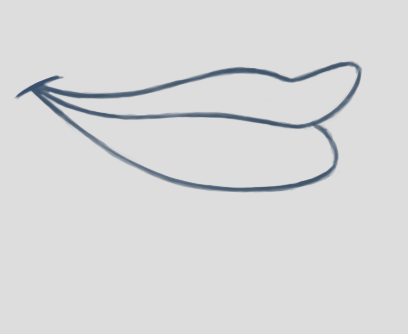
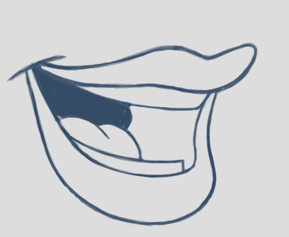
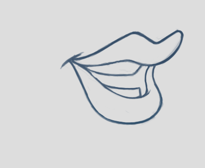
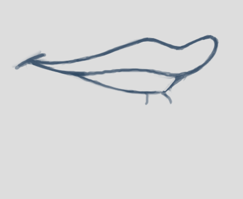
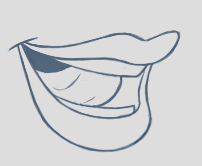

# lip-sync-engine

Lip-sync mouth shapes from speech audio, computed in the browser.

[](https://www.npmjs.com/package/lip-sync-engine)
[](./LICENSE)

`lip-sync-engine` is a WebAssembly port of [Rhubarb Lip Sync](https://github.com/DanielSWolf/rhubarb-lip-sync)
with a TypeScript API. Give it 16-bit PCM audio and it returns timed mouth-shape cues for animating
a character.

## Features

- Runs entirely in the browser with WebAssembly. No server is needed.
- Uses PocketSphinx speech recognition and Rhubarb's animation rules. Optional dialog text improves
  recognition.
- Outputs nine mouth shapes (A-H and X), or only the six basic shapes A-F.
- Analyzes on the main thread, in a pool of Web Workers, or as a stream of chunks for live audio.
- Includes helpers to record from the microphone, decode audio files and URLs, and convert PCM
  formats.
- Ships TypeScript type definitions and works with any framework.
- The library code is about 21 KB. At runtime it loads a 1.9 MB WebAssembly module and about
  39 MB of English speech model data, which the browser caches. Each Web Worker holds its own copy
  in memory.

## Installation

```bash
npm install lip-sync-engine
```

## Quick Start

```typescript
import { analyze, recordAudio } from 'lip-sync-engine';

// Record 5 seconds from the microphone, as 16 kHz PCM
const { pcm16 } = await recordAudio(5000);

const result = await analyze(pcm16, {
  dialogText: 'Hello world', // optional: the words being spoken
  sampleRate: 16000
});

for (const cue of result.mouthCues) {
  console.log(`${cue.start.toFixed(2)}-${cue.end.toFixed(2)} s: ${cue.value}`);
}
// 0.00-0.35 s: X
// 0.35-0.50 s: D
// 0.50-0.85 s: B
// ...
```

`analyze()` blocks the page while it runs. For interactive pages, use `analyzeAsync()` or
`WorkerPool` instead (see [Why Use Workers?](./docs/worker-usage.md#why-use-workers)).

React, Vue, and Svelte integration is covered in
[Getting Started: Framework Integration](./docs/getting-started.md#framework-integration). Runnable
apps are in [Examples](#examples). To upgrade from an earlier major version, see
[CHANGELOG.md](./CHANGELOG.md).

## Loading the WASM Files

By default the WebAssembly files and the worker script load from unpkg at the installed package
version (`https://unpkg.com/lip-sync-engine@<version>/dist/...`). This works with any bundler and
needs no configuration. To serve the files from your own origin, for example because a Content
Security Policy blocks unpkg.com, see
[Self-Hosting the WASM Files](./docs/getting-started.md#self-hosting-the-wasm-files).

## Examples

- [Vanilla JavaScript](./examples/vanilla/README.md)
- [React](./examples/react/README.md)
- [Vue](./examples/vue/README.md)
- [Svelte](./examples/svelte/README.md)

## Mouth Shapes

A-F are the basic Hanna-Barbera mouth shapes. G, H, and X are Rhubarb's extended shapes.

| Shape | Image | Description | Example Sounds |
|-------|-------|-------------|----------------|
| A |  | Closed (M, B, P) | **m**ap, **b**ig, **p**ot |
| B |  | Clenched teeth | most consonants, such as **s**, **t**, and **k**; ee as in b**ee** |
| C |  | Open | e as in m**e**n, a as in b**a**t |
| D |  | Wide open | a as in f**a**ther |
| E |  | Rounded | o as in **o**ff, er as in h**er** |
| F |  | Puckered | oo as in y**ou**, w as in **w**ay |
| G |  | F/V (upper teeth on lower lip) | **f**an, **v**an |
| H |  | L (tongue raised) | a held l, as in **l**ong |
| X |  | Idle | silence and pauses |

The `extendedShapes` option selects which extended shapes appear. The default is `'GHX'` (all
nine). Pass `''` for A-F only, or any subset such as `'X'`:

```typescript
import { analyze, loadAudio } from 'lip-sync-engine';

const { pcm16 } = await loadAudio('speech.mp3');
const result = await analyze(pcm16, { sampleRate: 16000, extendedShapes: '' }); // A-F only
```

## How It Works

1. **Speech recognition.** PocketSphinx finds the phones (speech sounds) in the audio and their
   timing. Dialog text, when given, guides the recognizer.
2. **Shape mapping.** The phones are mapped to [mouth shapes](#mouth-shapes).
3. **Animation rules.** Rhubarb's rules adjust the shapes and timing for natural transitions.
4. **Output.** The result is a list of mouth cues, each with a start time, an end time, and a shape.

## Streaming Quality

Short chunks analyzed one at a time lose most mouth shapes and often close the mouth at chunk
boundaries. With 250 to 1000 ms chunks, about 32-65% of frames match a whole-utterance analysis when
each chunk is analyzed alone, and 85-86% with `contextMs` and `lookaheadMs` at 500. See
[Context and Lookahead](./docs/streaming-analysis.md#context-and-lookahead) for usage, and
[BENCHMARK.md](./BENCHMARK.md#mouth-cue-quality) for the method, cost, and the phonetic recognizer
trade-off.

## How It Compares to Other Browser Lip-Sync Libraries

Against hand-checked phone timings, `lip-sync-engine` with context and lookahead scored 54.6%
balanced accuracy over five mouth classes, against 42.5% for HeadAudio and 42.1% for wlipsync, and
showed closed lips for 92% of m, b, and p sounds (under half for the others). HeadAudio and wlipsync
use far less CPU, have no start-up cost, and run with about 30 to 40 ms of delay. Setup, per-class
results, and limits are in
[BENCHMARK.md](./BENCHMARK.md#head-to-head-with-other-browser-lip-sync-libraries).

## API Overview

### Analysis

```typescript
import { analyze, analyzeAsync, LipSyncEngine, loadAudio } from 'lip-sync-engine';

const { pcm16 } = await loadAudio('speech.mp3');
const options = { dialogText: 'Hello world', sampleRate: 16000 };

// Main thread. Blocks the page while it runs.
const quick = await analyze(pcm16, options);

// Web Worker. Does not block the page, and starts the shared WorkerPool if needed.
// Start the pool yourself only to choose the worker count or self-hosted paths.
const inWorker = await analyzeAsync(pcm16, options);

// Main-thread class. init() is optional: analyze() calls it with the options of the last init(options) call, or the default paths.
const engine = LipSyncEngine.getInstance();
await engine.init();
const fromEngine = await engine.analyze(pcm16, options);
```

### Streaming Analysis

```typescript
import { WorkerPool } from 'lip-sync-engine';
import type { MouthCue } from 'lip-sync-engine';

// Create the pool once and keep it for the whole session.
// Two workers are enough for one voice; each uses about 115 MB.
const pool = WorkerPool.getInstance(2);
await pool.init();   // starts the first worker and builds its speech decoder
await pool.warmup(); // starts the remaining workers

// One stream analyzer per utterance
async function lipSyncUtterance(
  audioStream: AsyncIterable<Int16Array>,
  onCues: (index: number, cues: MouthCue[]) => void
): Promise<void> {
  const stream = pool.createStreamAnalyzer({
    sampleRate: 16000,
    contextMs: 500,  // earlier audio analyzed with each chunk
    lookaheadMs: 500 // later audio, waited for only while playback allows
  });

  const done: Promise<void>[] = [];
  for await (const chunk of audioStream) {
    const index = stream.addChunk(chunk); // returns at once
    done.push(
      stream.getResult(index)
        .then((result) => onCues(index, result.mouthCues)) // times relative to this chunk
        .catch((error: unknown) => console.error(`Chunk ${index} failed:`, error))
    );
  }

  stream.end(); // all audio received: analyze the remaining chunks
  await Promise.all(done);
}
```

How the analyzer schedules chunks, and when to change the defaults, is covered in
[Context and Lookahead](./docs/streaming-analysis.md#context-and-lookahead).

Other pool options (all optional):

```typescript
import { WorkerPool } from 'lip-sync-engine';

const pool = WorkerPool.getInstance(2);
await pool.init({
  prewarm: true,             // build each decoder during init()/warmup() (default); 'first': only the init() worker; false: on first job
  shareAssets: true,         // compile the .wasm once and reuse it in the other workers (default)
  recognizer: 'pocketsphinx' // default; 'phonetic' is faster but less accurate and ignores dialogText
});

// Reserved WebAssembly memory per worker, in bytes (can exceed the memory actually in use)
const { workers, totalBytes } = await pool.getMemoryStats();
```

See the [Streaming Analysis Guide](./docs/streaming-analysis.md) and the
[Web Worker Usage Guide](./docs/worker-usage.md) for complete usage patterns.

### Audio Utilities

```typescript
import {
  recordAudio,
  loadAudio,
  audioBufferToInt16,
  float32ToInt16,
  resample
} from 'lip-sync-engine';

// Record from the microphone (16 kHz by default)
const recording = await recordAudio(5000);

// Decode a file or URL (16 kHz by default)
const loaded = await loadAudio('speech.mp3');

// Convert formats
const fromBuffer = audioBufferToInt16(loaded.audioBuffer, 16000);
const samples48k = new Float32Array(48000); // for example, one second of 48 kHz audio
const downsampled = resample(samples48k, 48000, 16000);
const pcm16 = float32ToInt16(downsampled);
```

### Types

```typescript
interface MouthCue {
  start: number; // seconds
  end: number;   // seconds
  value: string; // A-H or X (A-F only with extendedShapes: '')
}

interface LipSyncEngineResult {
  mouthCues: MouthCue[]; // always present
  // Set as shown only by analyze(). Worker and stream results carry different
  // metadata, so rely on mouthCues.
  metadata?: {
    duration: number;
    sampleRate: number;
    dialogText?: string;
  };
}

interface LipSyncEngineOptions {
  dialogText?: string;     // the words being spoken; improves accuracy
  sampleRate?: number;     // sample rate of the buffer you pass (default 16000)
  extendedShapes?: string; // default 'GHX' (nine shapes); '' for A-F only
}
```

Streaming options (`StreamAnalyzerOptions`), the pool types, and every other class, option, and
error are in the [API Reference](./docs/api-reference.md).

## Development

Building from source, running the tests, and testing against the examples are covered in the
[Development Guide](./docs/development.md).

## License

MIT. See [LICENSE](./LICENSE).

## Credits

- [Rhubarb Lip Sync](https://github.com/DanielSWolf/rhubarb-lip-sync) by Daniel Wolf, which this
  library ports
- [PocketSphinx](https://github.com/cmusphinx/pocketsphinx) for speech recognition

## Issues

Report issues at [github.com/biolimbo/lip-sync-engine/issues](https://github.com/biolimbo/lip-sync-engine/issues).
