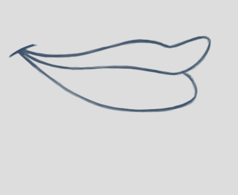

# Vanilla JavaScript Example

A single HTML page in plain JavaScript that records or loads audio, analyzes it in one of three execution modes, and plays the mouth shapes in sync with the audio.

The page loads the published package from unpkg at the version pinned in its `DIST` constant, so it needs no build step.

## Running the Example

Serve the `examples/` folder (the page loads images from `../assets/visemes/`) with any static file server:

```bash
# From examples/
python3 -m http.server 8000
# Open http://localhost:8000/vanilla/
```

Opening `index.html` straight from disk (`file://`) does not work: browsers block module scripts and Web Workers there.

### Testing a Local Build

To use the library built in this repository (`dist/`) instead of the CDN, serve the repository root and add `?local` to the URL. The page then loads `index.mjs`, `worker.js`, and the WASM files from `../../dist/`.

```bash
# From the repository root, after `npm run build`
python3 -m http.server 8000
# Open http://localhost:8000/examples/vanilla/?local
```

If your server sends `.mjs` files with the wrong MIME type (older Python versions do), use another static server such as `npx http-server`. For building the library, see [Testing Against the Examples](../../docs/development.md#testing-against-the-examples).

## Features

- Record from the microphone (5 to 60 seconds) or load an audio file in any format the browser can decode
- Optional dialog text for better accuracy
- Three execution modes:
  - Single Thread: runs on the main thread and blocks the UI
  - Web Worker: runs in one worker, so the UI stays responsive
  - Chunked: splits the audio and analyzes the chunks in parallel on up to 4 workers
- Metrics: execution time, cue count, audio duration, and workers used
- Mouth shape preview synced to audio playback, with Play and Stop controls
- List of all mouth cues with timestamps

## Using the Library in Your Own Page

### Option 1: CDN (unpkg)

Pin the version in every URL. With no paths, `init()` loads the WASM files and the worker script from unpkg at the same version as the imported library.

```html
<script type="module">
  import { LipSyncEngine, WorkerPool } from 'https://unpkg.com/lip-sync-engine@2.0.0/dist/index.mjs';

  // Main thread
  const lipSyncEngine = LipSyncEngine.getInstance();
  await lipSyncEngine.init();

  // Web Workers (recommended for anything longer than a few seconds)
  const pool = WorkerPool.getInstance(4);
  await pool.init();
</script>
```

`WorkerPool.getInstance()` returns one shared pool: its arguments (here, at most 4 workers) apply only when the pool is first created.

### Option 2: Self-Hosted

Copy the library files to your own server and pass their URLs to `init()`. See [Self-Hosting the WASM Files](../../docs/getting-started.md#self-hosting-the-wasm-files).

### Option 3: Using a Bundler (Vite, Webpack, and Others)

See the [React](../react/README.md), [Vue](../vue/README.md), or [Svelte](../svelte/README.md) example.

## How It Works

The blocks below are steps of one module script: each continues the previous one.

### 1. Initialize Once and Keep Alive

```javascript
import { LipSyncEngine, WorkerPool, recordAudio, loadAudio } from 'https://unpkg.com/lip-sync-engine@2.0.0/dist/index.mjs';

const lipSyncEngine = LipSyncEngine.getInstance();
await lipSyncEngine.init();

const pool = WorkerPool.getInstance(4);
await pool.init();   // starts one worker
await pool.warmup(); // starts the other three; required for parallel analysis
```

Create the pool once and reuse it for every analysis. See [Pool Lifecycle and Sizing](../../docs/worker-usage.md#pool-lifecycle-and-sizing).

### 2. Get Audio Data

- Record from the microphone: `const { pcm16, audioBuffer } = await recordAudio(5000);`
- Load from a file: `const { pcm16, audioBuffer } = await loadAudio(file);`

Both return mono 16 kHz Int16 PCM, which is what `sampleRate: 16000` below describes.

### 3. Analyze

```javascript
const result = await pool.analyze(pcm16, {
  dialogText: 'Hello world',
  sampleRate: 16000
});
```

Chunked mode splits the audio and uses `pool.analyzeChunks()`. Cue times in each chunk's result are relative to that chunk, so add the chunk's start time:

```javascript
const chunkSamples = 5 * 16000; // 5-second chunks
const chunks = [];
for (let i = 0; i < pcm16.length; i += chunkSamples) {
  chunks.push(pcm16.subarray(i, i + chunkSamples));
}

const chunkResults = await pool.analyzeChunks(chunks, { sampleRate: 16000 });
const chunkedCues = chunkResults.flatMap((chunkResult, i) => {
  const offset = (i * chunkSamples) / 16000;
  return chunkResult.mouthCues.map((cue) => ({ ...cue, start: cue.start + offset, end: cue.end + offset }));
});
```

Each chunk is analyzed on its own, so cues near chunk edges are less accurate; that is fine for chunks of a few seconds. For short chunks from a live stream use `pool.createStreamAnalyzer({ sampleRate: 16000, contextMs: 500, lookaheadMs: 500 })`. See [`stream-example.ts`](../stream-example.ts) and [Context and Lookahead](../../docs/streaming-analysis.md#context-and-lookahead).

### 4. Animate the Mouth Shapes

```javascript
//  and so on, one per shape
const visemeImages = document.querySelectorAll('#visemeImages img');

function setViseme(shape) {
  visemeImages.forEach((img) => img.classList.toggle('active', img.dataset.viseme === shape));
}

let audioContext = null; // created on the first click, then reused
let currentSource = null;
let animationFrame = null;

function stopPlayback() {
  if (animationFrame !== null) cancelAnimationFrame(animationFrame);
  animationFrame = null;
  if (currentSource) {
    currentSource.onended = null;
    currentSource.stop();
    currentSource = null;
  }
  setViseme('X');
}

function playAnimation(mouthCues, audioBuffer) {
  stopPlayback(); // stop the previous playback and its animation loop

  audioContext ??= new AudioContext();
  audioContext.resume(); // a context created outside a user gesture starts suspended

  const source = audioContext.createBufferSource();
  source.buffer = audioBuffer;
  source.connect(audioContext.destination);
  source.onended = () => { currentSource = null; };
  currentSource = source;
  const startTime = audioContext.currentTime;
  source.start();

  let i = 0;
  function update() {
    const elapsed = audioContext.currentTime - startTime;
    while (i < mouthCues.length && mouthCues[i].end < elapsed) i++;
    if (i < mouthCues.length) {
      setViseme(mouthCues[i].value);
      animationFrame = requestAnimationFrame(update);
    } else {
      setViseme('X');
      animationFrame = null;
    }
  }
  update();
}

document.getElementById('playBtn').addEventListener('click', () => {
  playAnimation(result.mouthCues, audioBuffer);
});
```

## Mouth Shape Images

The page stacks nine PNG images (A to H and X) from `../assets/visemes/` with absolute positioning and shows one at a time by switching opacity, so changes are instant. For what each shape means, see [Mouth Shapes](../../README.md#mouth-shapes).

## Browser Requirements

- ES module support
- WebAssembly
- Web Audio API
- MediaDevices API (for microphone recording)

## Tips

1. **Dialog text**: provide it when you know what will be spoken; it improves accuracy.
2. **Audio quality**: clear audio with little background noise works best.
3. **File formats**: any format the browser can decode works, such as MP3, WAV, or OGG.
